# 🏡 Min-Max Normalization & PCA on Housing Data

**Team:** Group 1 &nbsp;·&nbsp; **Members:** Sultan Atanda · John Buni · Eche Oji · Antonio Sainz
**Notebook:** [`MinMax_Normalization_Workshop.ipynb`](MinMax_Normalization_Workshop.ipynb) &nbsp;·&nbsp; **Data:** 2,000 houses, 6 numeric features

> **The question we set out to answer:** when housing features live on completely different scales, what goes wrong, how does min-max normalization fix it, and once everything is on one scale, which features actually matter?

---

## 🎤 Presentation Run Sheet

| Section | Presenter |
|---|---|
| [1. Goal, data and workflow](#1-goal-data-and-workflow) | Sultan |
| [2. The problem and the fix: min-max normalization](#2-the-problem-and-the-fix-min-max-normalization) | John |
| [3. Covariance and how PCA works](#3-covariance-and-how-pca-works) | Eche |
| [4. PCA results](#4-pca-results) | Antonio |
| [5. Feature importance, impact and conclusions](#5-feature-importance-impact-and-conclusions) | Sultan |
| [Insights summary](#-insights-summary-in-notebook-order) | Sultan |

---

## 1. Goal, data and workflow

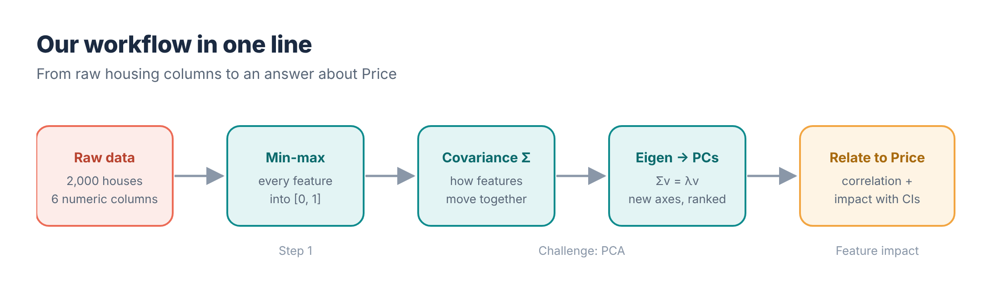

- **Data:** 2,000 houses with `Price`, `Area_sqft`, `Num_Bedrooms`, `Num_Bathrooms`, `Year_Built`, `Lot_Size`. No missing values, no duplicates.
- **Step 1:** implement min-max normalization by hand (no numpy or sklearn), then check it against sklearn — the largest difference is **2 × 10⁻¹⁵**.
- **Challenge:** run PCA on the normalized features, then test whether the components relate to `Price`.
- **Extra:** covariance analysis and a feature-impact model with confidence intervals.

---

## 2. The problem and the fix: min-max normalization

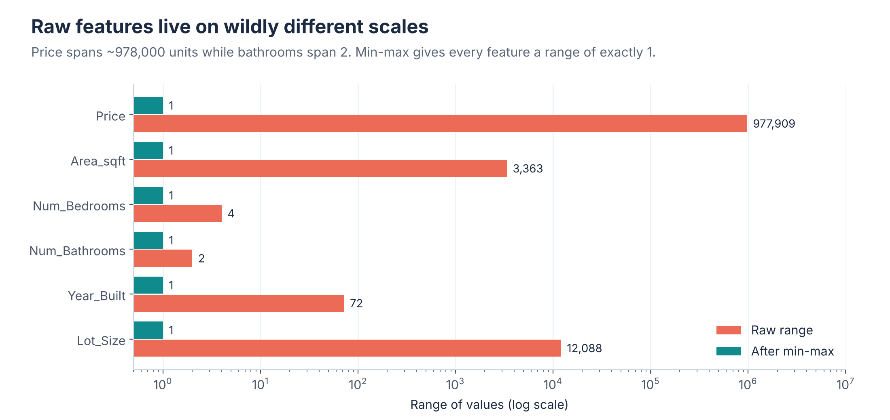

**The problem.** Price spans about **978,000** units while bathrooms span **2**. Any algorithm that adds up distances or weighted sums will listen to the big numbers and ignore the small ones.

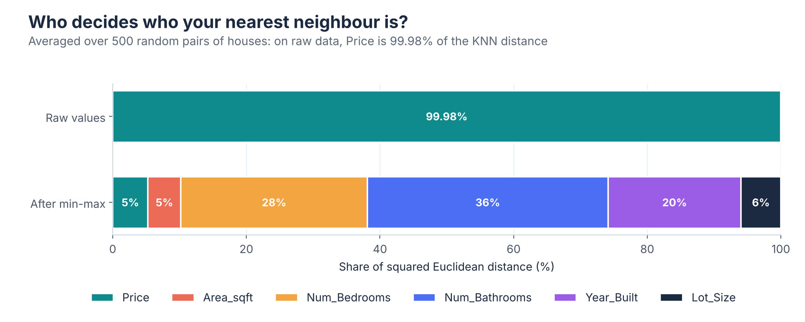

- On raw data, **Price is 99.98%** of the KNN distance between two houses. A "nearest neighbour" is just the house with the closest price.
- In gradient descent the update for each weight scales with its input, so Price-scale weights move about **100,000× faster** than bathroom weights. One learning rate cannot fit both.

**The fix.**

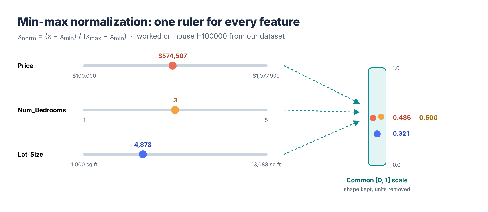

$$x_{\text{norm}} = \frac{x - x_{\min}}{x_{\max} - x_{\min}}$$

| Feature (house H100000) | Raw | Min | Max | Normalized |
|---|---:|---:|---:|---:|
| Price | 574,507 | 100,000 | 1,077,909 | **0.485** |
| Num_Bedrooms | 3 | 1 | 5 | **0.500** |
| Num_Bathrooms | 3 | 1 | 3 | **1.000** |
| Year_Built | 2002 | 1950 | 2022 | **0.722** |
| Lot_Size | 4,878 | 1,000 | 13,088 | **0.321** |

**What we learned:**
- Min-max equalizes **range, not influence.** After scaling, bathrooms (36%) and bedrooms (28%) carry the most KNN distance, because their few values sit at 0, 0.5 and 1.
- It is **sensitive to outliers:** the single most expensive house sets the top of the Price scale for everyone.
- In production, fit min and max on **training data only** and reuse them for new houses.

---

## 3. Covariance and how PCA works

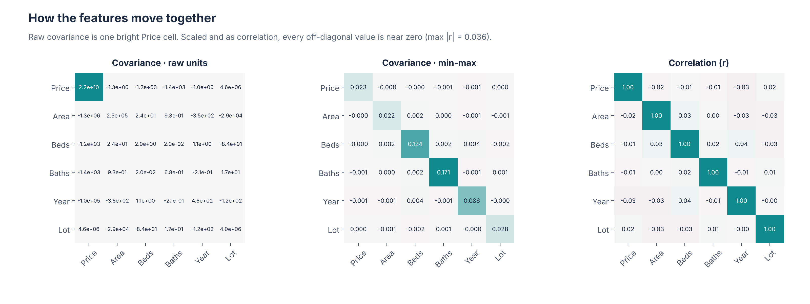

- **Raw covariance** is one bright square: Price's variance (≈ 2.2 × 10¹⁰) hides everything else.
- **After min-max** the diagonal shows each feature's spread inside [0, 1]. Bathrooms (0.17) and bedrooms (0.12) are widest; area and lot size (≈ 0.02) are narrow.
- **Correlation** confirms the features barely move together: the strongest pair is bedrooms ↔ year built at **r = 0.036**.
- In the notebook this chart is **interactive**: a dropdown switches between the three views, and a filter (features + minimum |r|) hides weak pairs.

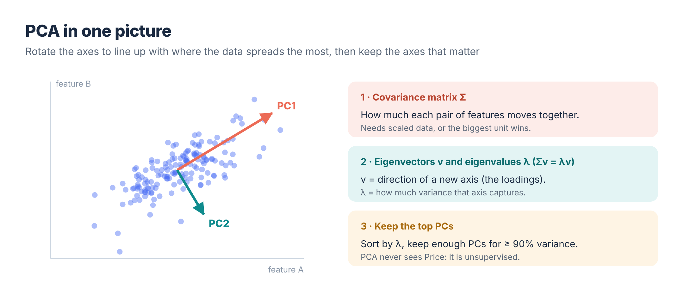

We followed the course method step by step: **covariance matrix → eigen-decomposition (`np.linalg.eigh`) → sort by eigenvalue → project the data.** Our manual results match sklearn's `PCA` to within **10⁻¹⁶**.

---

## 4. PCA results

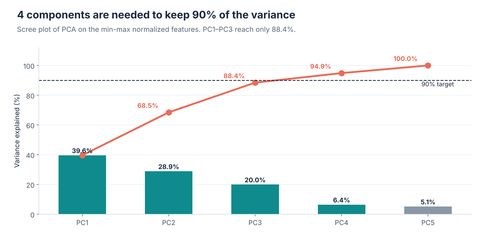

**Q1. How many PCs explain ≥ 90% of the variance? → Four.** The first three reach only 88.4%; PC4 brings it to 94.9%.

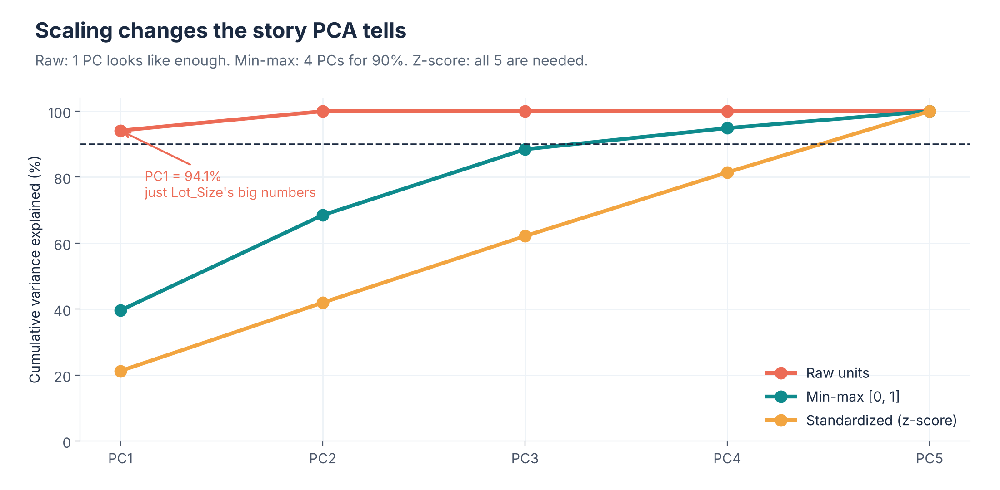

**Why normalize before PCA:** on raw units PC1 claims **94.1%** of the variance, but that is only `Lot_Size`'s large numbers. After min-max we need 4 PCs, and after z-scoring all 5.

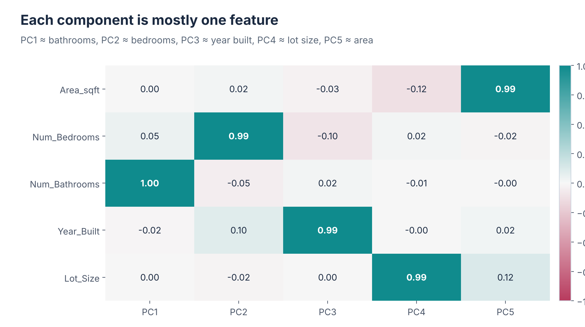

**Q2. What drives PC1 and PC2?** PC1 ≈ **Num_Bathrooms** (loading 0.999). PC2 ≈ **Num_Bedrooms** (0.993).

**Q4. What does PC1 mean?** "How many bathrooms the house has" — *not* a general house-size factor, because area, lot size and room counts do not move together in this data. With nearly independent features, PCA has nothing to merge, so each PC is basically one original feature.

---

## 5. Feature importance, impact and conclusions

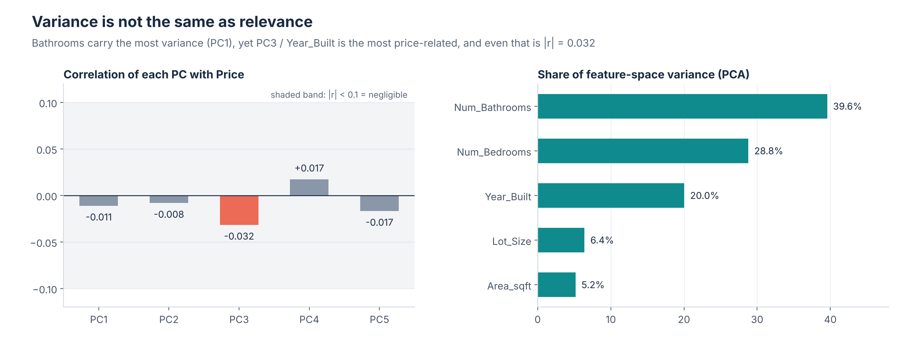

**Q3. Which PC is most correlated with Price? → PC3** (≈ `Year_Built`), at only **r = −0.032**. The components with the most variance (PC1, PC2) are *not* the ones most related to Price.

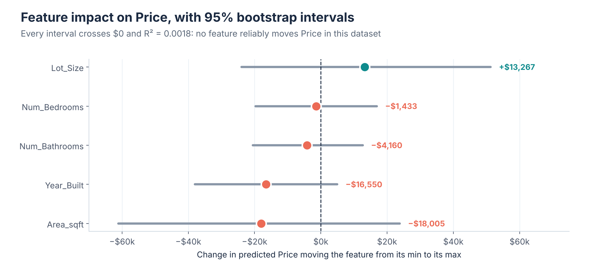

- Because each feature runs 0 → 1 after min-max, a regression coefficient reads as **"the price change from the lowest to the highest value."**
- The largest estimates are area (−$18k) and year built (−$16.5k), but **every 95% bootstrap interval crosses $0** and **R² = 0.0018**.
- Conclusion: in this dataset, size, rooms and age do not reliably explain price. A real model would need other information such as location or condition.

---

## 📝 Insights Summary (in notebook order)

**Talking Points #1: Why normalization matters**
1. **KNN:** on raw data, Price is 99.98% of the distance, so neighbours are chosen by price alone. After scaling, every feature counts.
2. **Gradient descent:** big inputs like Price get much bigger updates than small ones like bathrooms. With all features on 0–1, training is even and stable.
3. **Housing features:** Price spans ~978,000 and bathrooms only 2. Min-max puts them on one scale, but outliers set the top of that scale.

**Challenge Deliverable: PCA answers**
1. **PCs for ≥ 90% variance:** 4 (three PCs reach only 88.4%).
2. **Top contributors:** PC1 = bathrooms, PC2 = bedrooms.
3. **PC most related to Price:** PC3 (mostly Year_Built), but the link is tiny (r = −0.032).
4. **What PC1 represents:** "number of bathrooms." The features don't move together, so each PC is mostly one feature.
- **Do the biggest PCs relate most to Price?** No. They hold the most variance but have almost no link to Price.

**Talking Points #2: What PCA, covariance and feature impact taught us**
1. **Scale before PCA:** on raw data PC1 seems to explain 94%, only because of Lot_Size's big numbers.
2. **PCA needs related features:** ours are almost unrelated (max r = 0.036), so PCA can't combine them.
3. **More variance ≠ more important:** the top PCs barely relate to Price, and no feature reliably predicts it (R² = 0.0018).

---

## 🗂️ Repository Structure

```
├── MinMax_Normalization_Workshop.ipynb   completed team notebook
├── data/housing_data.csv                 dataset
├── src/
│   ├── normalizer.py                     MinMaxNormalizer (pure Python)
│   ├── pca_analyzer.py                   PCAAnalyzer (covariance → eigen → PCs)
│   ├── feature_insights.py               FeatureInsights (covariance filter, KNN share, price impact)
│   └── visualizer.py                     HousingVisualizer (interactive Plotly charts)
├── images/                               figures used in this README
└── requirements.txt
```

## ▶️ How to Run

```bash
python -m venv .venv
.venv\Scripts\activate          # macOS/Linux: source .venv/bin/activate
pip install -r requirements.txt
```

Open the notebook and choose **Run All**. All charts are interactive Plotly figures; the covariance explorer uses `ipywidgets`. The cells follow the same order as the professor's notebook: Step 1 → Talking Points #1 → PCA Steps A–F → Challenge Deliverable → Talking Points #2.

**Tools:** Python 3.12 · pandas · NumPy · scikit-learn · Plotly · ipywidgets
